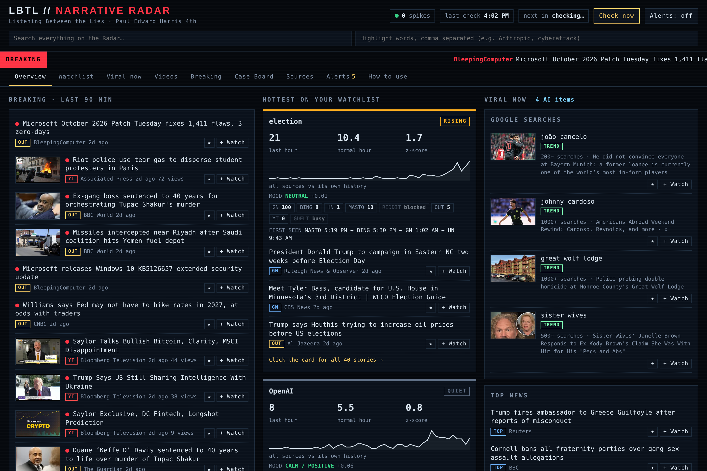
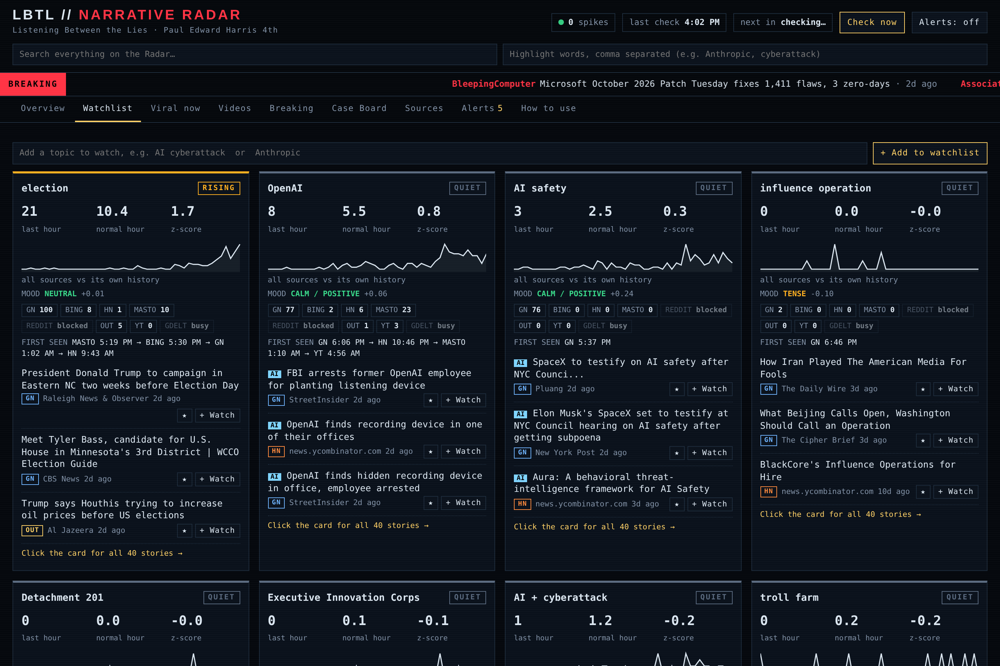
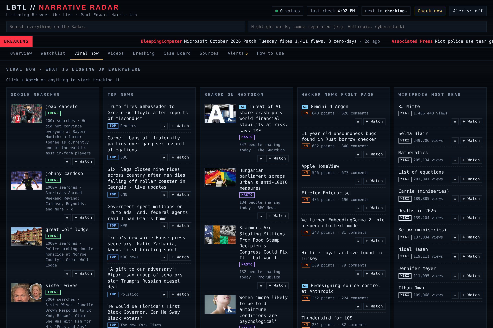

# Narrative Radar

**A real-time news and narrative monitor built for the video podcast *Listening Between the Lies*.**
It watches a list of topics across news and social sources every 15 minutes, flags when a topic suddenly surges, and puts breaking news, viral trends and news video on one screen, so a story can be caught early.

## What it does

- **Watchlist with spike alerts.** Every 15 minutes it counts how much each topic is being covered and compares the last hour to that topic's own normal. A big jump (z-score of 3 or more) raises an alert and logs it.
- **Many free sources at once.** GDELT, Google News, Bing News, Hacker News, Mastodon and Reddit, plus 15 outlet feeds (wire services, tech, cybersecurity, disinformation researchers) and 13 YouTube news and AI channels.
- **Who covered it first.** Each topic shows which platform carried a story first and in what order it spread.
- **Mood.** Headlines are scored from hostile to positive with VADER sentiment analysis.
- **Viral now.** Google Trends, Google top news, the most-shared links on Mastodon, the Hacker News front page and Wikipedia's most-read pages, with AI-related items flagged.
- **Case Board.** Pin stories, label them (lead, evidence, claim to check) and export research notes for an episode.

| Watchlist | Viral now |
| --- | --- |
|  |  |

## Run it (Windows)

1. Install Python 3.10 or newer from python.org.
2. Double-click **Start Narrative Radar.bat**. It installs the one extra package it needs and opens the Radar at `http://localhost:8765`.
3. Edit `watchlist.txt` (one topic per line) or add topics from the page.

Optional: **Install 24-7 (start at login).bat** starts it automatically when you log in.

It runs entirely on your own computer. No accounts or API keys are needed. Everything it reads is public.

## Also in this repo

- **`Narrative-Radar-Guide.png`**: a picture guide to every part of the screen. The Radar's help panel links to it.
- **`deep-dive tools/`**: the earlier offline analysis scripts (Narrative Tracker v0). They group headlines into narratives and chart how each spreads. They need `pandas`, `numpy`, `matplotlib` and `scikit-learn`. The `data/` folder isn't included: create it, then run `python make_sample.py` for made-up practice data, or `collect.py` for real public headlines.

## How it works

`engine/watch.py` runs the loop. `sources.py` and `feeds.py` collect, `trending.py` reads the viral feeds, `mood.py` scores tone, and `server.py` serves the page (`app.html`) on localhost with a small JSON API for the buttons.
Spike detection compares each reading to the topic's own rolling baseline (z-score), so a topic that is always busy doesn't trigger constant alerts.

## Status

Working prototype (v0.1), used daily for show research. Limits: it only sees public sources; X, LinkedIn, Facebook, Instagram and TikTok don't offer free search, and Reddit often blocks automated access.

## About

Built by **Paul Edward Harris 4th** ([GitHub](https://github.com/seek-k-nowledge)) as an independent project, with heavy AI assistance (Claude) for the code.
Companion project: [Firm Radar](https://github.com/seek-k-nowledge/firm-radar), the client-monitoring version.

## License

MIT. See [LICENSE](LICENSE).
